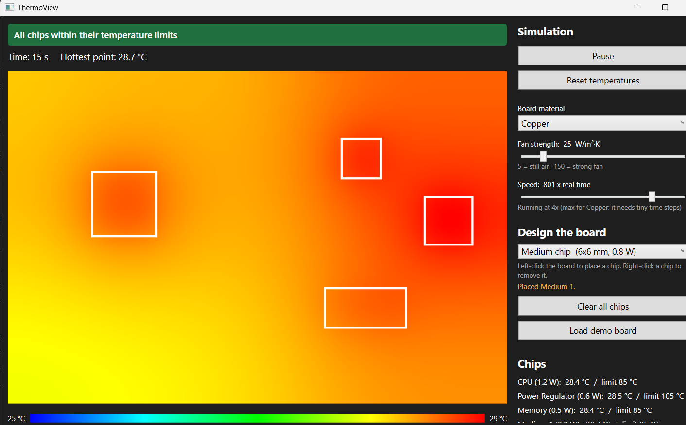

# ThermoView

**A thermal simulator for circuit board design.** Place chips on a board, pick a material and fan strength, and watch heat spread in real time. ThermoView flags any chip that runs past its temperature limit.

Built with C#, .NET 10, WPF (MVVM) and xUnit.



## Why I built it

Every electronic board has the same problem: chips turn electricity into heat, and if that heat can't escape, the chip overheats. Engineers use simulation software to catch this **before** a board is built. ThermoView is a small version of that idea, written from scratch so I could understand how the physics and the software fit together.

## Features

- **Live heat map** that animates as heat flows from hot to cold
- **Click to place chips** of different sizes and power levels, right-click to remove them
- **Overheating warnings**: each chip has a temperature limit, and the app names the worst offender
- **Board materials**: FR4 (standard circuit board), aluminum, copper
- **Fan strength slider** that changes cooling live
- **Simulation speed control** that adapts to how fast the computer can keep up
- **16 unit tests**, including physics checks like energy balance

## How it works

The board is split into a grid of 1 mm squares. Every time step, each square does three things:

```
new temp = current temp
         + heat spreading in from its 4 neighbors     (conduction)
         + heat produced by any chip on top of it     (heat source)
         - heat carried away by the air               (convection)
```

This is the **2D heat equation** solved with the **explicit finite difference method**. A few details that matter:

- **Stability limit.** If the time step is too large, the numbers blow up. The time step is capped at `cellSize² / (4 × diffusivity)`, which is why copper (which moves heat about 750x faster than FR4) needs much smaller steps and runs slower.
- **Double buffering.** Every square is updated from the *previous* step's temperatures, written into a second array, and the two arrays are swapped. The spare array is reused so the simulation doesn't allocate memory every step.
- **Insulated edges.** The sides of the board don't leak heat. All cooling happens through the surface, like a real board in air.

## Architecture

```
ThermoView.Core    the physics: grid, materials, chips, color map (no UI code)
ThermoView.App     the WPF window, built with MVVM
ThermoView.Tests   xUnit tests for the physics and placement logic
```

The physics engine knows nothing about the UI, so it can be tested on its own and could be reused behind a different interface. The window binds to a `MainViewModel`, so the code-behind only translates mouse clicks into grid squares.

## Tests

The tests check physical laws rather than exact numbers:

| Test | What it proves |
|---|---|
| Hot spot spreads to neighbors | Heat flows from hot to cold |
| Temperatures stay in the starting range | Heat can't appear from nowhere, and the time step is stable |
| Uniform board stays uniform | No temperature difference means no heat flow |
| Fan keeps the board cooler | Stronger convection lowers the peak temperature |
| Steady state: heat out equals heat in | Energy is conserved (first law of thermodynamics) |
| Chip placement and overlap rules | Chips stay on the board and can't stack |

Run them with:

```
dotnet test
```

## Running it

**Download:** grab `ThermoView-win-x64.zip` from the [Releases](../../releases) page, unzip it, and double-click `ThermoView.App.exe`. Windows only, nothing else to install.

**From source** (needs the .NET 10 SDK):

```
git clone https://github.com/<your-username>/ThermoView.git
cd ThermoView
dotnet run --project ThermoView.App
```

## Known simplifications

- The board is treated as a single thin layer, with no heat flow through its thickness.
- Where two different materials touch, each square uses its own diffusivity, which isn't perfectly energy conserving at the boundary.
- The explicit method is simple but slow for highly conductive materials.

## What's next

- An implicit / steady-state solver, so copper boards solve instantly
- Validation against a known textbook solution
- Live Mode: drive the simulated CPU with my laptop's real power sensor and compare simulated vs. measured temperature
- An optimizer that searches for the chip layout with the lowest peak temperature
